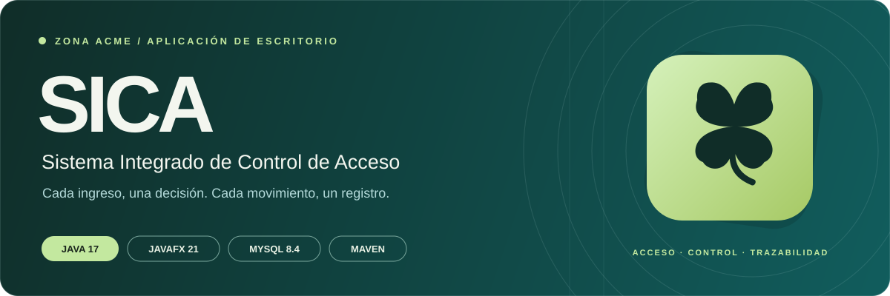
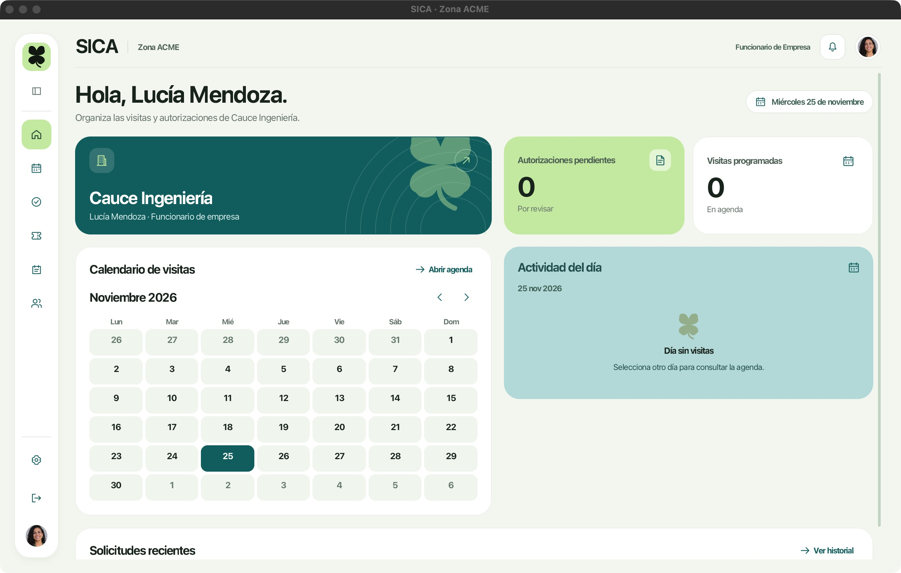
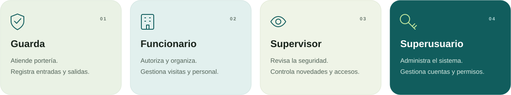
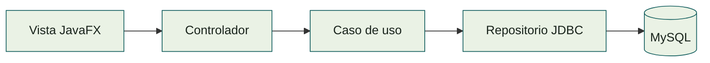

<p align="center">
  
</p>

<p align="center">
  <strong>Accesos organizados. Decisiones registradas.</strong><br>
  Proyecto académico de escritorio para gestionar el ingreso de trabajadores e invitados a Zona Acme.
</p>

## Sobre SICA

**SICA** significa **Sistema Integrado de Control de Acceso**. Su propósito es organizar la atención de trabajadores e invitados que llegan a las empresas de **Zona Acme**, conectando las responsabilidades de portería, funcionarios y seguridad.

El sistema permite conocer quién solicita entrar, quién autoriza, cuándo se registra el ingreso y cómo termina la visita. Las decisiones relevantes quedan en una bitácora para consultar posteriormente lo ocurrido y su responsable.

## Vista previa

<p align="center">
  
  <br>
  <sub>Captura real de la aplicación. Los datos dependen de la cuenta y de la base conectada.</sub>
</p>

## ¿Qué permite hacer?

- Programar visitas y aprobar o rechazar solicitudes de ingreso.
- Registrar entradas, salidas y pases por carnet olvidado.
- Gestionar empresas, cuentas, trabajadores y permisos.
- Consultar restricciones, incidentes, movimientos y auditoría.
- Revisar automáticamente autorizaciones vencidas e ingresos sin salida registrada mientras la aplicación está inicializada y abierta.

## Cuatro perfiles

<p align="center">
  
</p>

Las operaciones se autorizan según los permisos del rol y el alcance de la cuenta.

| Perfil | Responsabilidad principal |
| :--- | :--- |
| **Guarda de seguridad** | Consulta documentos, envía solicitudes y registra entradas y salidas desde portería. |
| **Funcionario de empresa** | Programa visitas, responde solicitudes y administra los trabajadores de su empresa. |
| **Supervisor de seguridad** | Consulta accesos, registra incidentes y gestiona prohibiciones de ingreso. |
| **Superusuario** | Administra empresas, cuentas y permisos, y consulta la auditoría general. |

## Situaciones de ingreso

- **Invitado con visita programada:** el funcionario agenda la visita y el guarda comprueba la autorización antes de registrar la entrada. El intervalo permitido va desde una hora antes hasta una hora después de la cita.
- **Invitado sin anuncio previo:** el guarda envía una solicitud al funcionario destinatario. Si se aprueba, permite ingresar durante los siguientes 30 minutos, sujeto a las demás condiciones de acceso.
- **Trabajador con carnet:** se comprueban su identidad, vinculación laboral, empresa y estado de acceso para registrar el ingreso habitual.
- **Trabajador con carnet olvidado:** se solicita autorización al funcionario. El pase aprobado dura 30 minutos, con límite al finalizar ese día.

Las autorizaciones vencidas sin entrada se marcan como expiradas. Cuando un ingreso cumple 24 horas sin salida registrada, el sistema lo cierra conservando desconocida la hora real de salida. Estas revisiones funcionan mientras la aplicación está inicializada y abierta.

## Tecnologías y arquitectura

**Java 17 · JavaFX 21 · FXML · CSS · MySQL 8.4 · JDBC · HikariCP · Maven**

La organización MVC separa las pantallas, sus controladores y el modelo. Las reglas de funcionamiento se mantienen separadas del SQL.



Los casos de uso acceden a los datos mediante interfaces. Las transacciones coordinan los guardados y la auditoría; las contraseñas se procesan con PBKDF2. Las consultas a MySQL se ejecutan en segundo plano para mantener disponible la ventana.

| Patrón | Aplicación en el proyecto |
| :--- | :--- |
| **Repository** | Separa las operaciones de datos de las consultas SQL. |
| **Abstract Factory** | Construye los repositorios que comparten la conexión de una transacción. |
| **Strategy** | Calcula el horario permitido según el tipo de autorización. |
| **Adapter** | Convierte resultados de los casos de uso en datos para las pantallas. |
| **Observer** | Utiliza propiedades y listeners de JavaFX para responder a cambios visuales. |

El código se distribuye en `model`, que contiene entidades y casos de uso; `infrastructure`, que implementa persistencia y seguridad; `presentacion`, que organiza la interfaz; y `config`, que conecta los servicios. Los recursos incluyen FXML, estilos, imágenes y scripts SQL.

## Ejecutar en local

**Requisitos:** JDK 17 o posterior, Maven y MySQL 8.4 en ejecución. Abre la terminal en la carpeta que contiene `pom.xml`.

**1. Prepara una base nueva.** Ejecuta estos scripts en orden con una cuenta de MySQL que pueda crear la base, las tablas y los triggers:

```bash
mysql --host=127.0.0.1 --port=3307 --user=TU_USUARIO_MYSQL --password < src/main/resources/db/schema.sql
mysql --host=127.0.0.1 --port=3307 --user=TU_USUARIO_MYSQL --password < src/main/resources/db/data.sql
```

Los scripts iniciales se ejecutan una sola vez sobre una base nueva; `data.sql` requiere tablas vacías.

**2. Configura la conexión** en [`config.properties`](src/main/resources/config.properties):

```properties
db.url=jdbc:mysql://127.0.0.1:3307/sica
db.user=TU_USUARIO_MYSQL
db.password=TU_CONTRASENA_MYSQL
```

Sustituye las credenciales por las de tu instalación y ajusta el puerto si corresponde. La conexión requiere TLS de forma predeterminada (`sslMode=REQUIRED`). Conserva tus contraseñas privadas fuera de los cambios que publiques.

**3. Inicia la aplicación:**

```bash
mvn javafx:run
```

Maven descarga las dependencias en la primera ejecución. Para compilar y generar el JAR en `target/`, utiliza `mvn package`.

## Cuentas de demostración

Se crean al cargar [`data.sql`](src/main/resources/db/data.sql). La contraseña compartida es **`SicaDemo2026!`**.

| Perfil | Correo |
| :--- | :--- |
| Superusuario | `admin@sica.local` |
| Supervisor de seguridad | `supervisor@sica.local` |
| Guarda de seguridad | `guarda@sica.local` |
| Funcionario · Empresa Sol | `ana@sol.sica.local` |
| Funcionario · Empresa Luna | `marta@luna.sica.local` |

Los datos del script son de demostración y las autorizaciones pueden vencer con el tiempo. Para probar la comunicación entre dos instancias, ambas deben utilizar la misma base de datos.

### Recorrido sugerido

1. Ingresa como funcionario y programa una visita con fecha y hora vigentes.
2. Cambia a la cuenta del guarda, consulta el documento y registra la entrada cuando se cumplan las condiciones.
3. Registra la salida desde portería.
4. Revisa los movimientos y la auditoría desde el perfil de supervisor.
5. Explora las empresas, cuentas y permisos como superusuario.

---

<p align="center">
  <strong>SICA · Zona Acme</strong><br>
  Proyecto académico · <a href="https://github.com/emilyforero2017-arch">emilyforero2017-arch</a>
</p>
